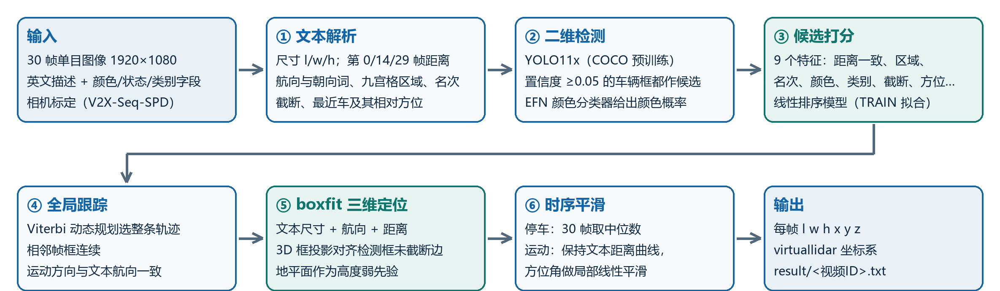

# Tenn-VLSOT-Geo：文本约束的几何三维视觉语言跟踪

**2026 VLP 挑战赛参赛作品**｜望远队（长安大学 数据科学与人工智能研究院）｜专项命题挑战赛 赛道 A：VLSOT（基于单目视频的 3D 视觉语言跟踪）

- VLP 平台方法：Tenn-VLSOT-Geo，方法页 <http://vlp.chd.edu.cn/tasks/method/301>
- 本仓库对应 2026-10-24 16:30（平台显示时间）提交的 **v12f** 版本，复现核对见下文
- 模型权重与参数：百度网盘 <https://pan.baidu.com/s/1-56d3pIsJE30FOMGDlNdXw?pwd=pgu8>，提取码 `pgu8`，内容见“权重下载”
- 技术报告（PPT，5 页，含方法概述、创新点、实验结果与消融）：[`reports/wangyuan_vlsot_geo_ppt_5p.pptx`](reports/wangyuan_vlsot_geo_ppt_5p.pptx)，PDF 版 [`reports/wangyuan_vlsot_geo_ppt_5p.pdf`](reports/wangyuan_vlsot_geo_ppt_5p.pdf)
- 队员：滕恒基（队长）、梁天宇、苗富敬、刘帅、安子茜；指导老师：孙士杰

## 成绩

| | SR@0.5 | SR@0.7 | AOR | PR@1.0 | ACE (m) | PR@0.5 |
|---|---|---|---|---|---|---|
| VLP 平台测试集（v12f） | 61.6667 | 38.3333 | 57.8363 | 16.6667 | 0.2259 | 1.6667 |
| TRAIN 5 折交叉验证（227 段，按目标分组） | 88.41 | 69.16 | 70.57 | 38.63 | 0.498 | 12.69 |

2026-10-26 的排行榜上，本方法 SR@0.5 排第 3（14 个有成绩的方法），ACE 在 SR@0.5 > 0 的 10 个方法中最低。
交叉验证的 PR@1.0 / PR@0.5 按中心误差 < 0.1 m / < 0.05 m 统计，与平台对本方法给出的数值口径一致。

## 方法概述



不训练三维网络。描述里给出了第 0/14/29 帧目标到相机的距离（精确到 0.1 m）、长宽高和航向，本方法先选出描述所指的目标，再把这些度量信息代入相机几何，把 2D 框解成 3D 框：

1. **文本解析**：尺寸、三处距离（过三点二次插值成逐帧距离）、航向与朝向词、九宫格区域、名次、截断状态、最近车的相对方位。
2. **检测与颜色**：YOLO11x（COCO 预训练，未微调）检测车辆；EFN 颜色分类器给出每个框的颜色概率。
3. **候选打分**：9 个特征（距离一致、类别、置信度、区域、截断、颜色、宽高比、名次、相对方位），线性模型，softmax 排序损失，只用 TRAIN 训练。区域、名次、相对方位按数据集描述生成规则计算。
4. **全局跟踪**：30 帧 Viterbi，二元代价为相邻帧 2D IoU 与运动方向—文本航向一致性。
5. **boxfit 三维定位**：已知尺寸 (l, w, h)、航向和距离 r，把中心写成 (x, y) = r(cosθ, sinθ)，搜索 θ 与 z，使三维框投影的外接矩形与检测框**未截断**的边对齐（离图像边界 10 px 内的边不参与），高度以全局地平面为弱先验（`vlsot_geo/boxfit.py`）。
6. **时序平滑**：停车目标取 30 帧中位数；运动目标保持文本距离曲线，只对方位角做 ±3 帧局部线性平滑。

可学习参数共 18 个（打分权重 9、地平面 3、框中心偏移 2、boxfit 边噪声 4），全部只在 227 段 TRAIN 上拟合，写在 [`params/params_v12f.json`](params/params_v12f.json)。

## 仓库结构

```
configs/v12f.args          最终配置（pipeline3.py 的命令行参数）
params/params_v12f.json    在 227 段 TRAIN 上拟合出的全部参数（--load_params 直接使用）
scripts/run_final.sh       完整流程：检测 → 颜色 → 5 折交叉验证 → 测试集提交文件
scripts/run_ablation.sh    消融表（PPT 第 4 页）的 9 行配置
results/                   提交文件的逐文件 SHA256、ONNX 一致性核对结果
vlsot_geo/
  pipeline3.py             主程序（目标选择、三维定位、平滑、评测、写提交文件）
  geo_common.py            数据读取、标定、投影、文本解析、评测指标
  boxfit.py                截断感知的三维框投影拟合
  det.py / det_onnx.py     YOLO11x 检测（PyTorch / ONNX 两种实现）
  efn_color.py             EFN 颜色概率（Keras / ONNX 两种后端）
  clip_color.py            CLIP 颜色概率（只用于 v9 对照）
  export_onnx.py           YOLO11x、EFN 转 ONNX
  check_onnx.py            ONNX 与原始权重的一致性核对
  cv_agg.py / cv_pair.py   交叉验证汇总、配对比较与 bootstrap 区间
  viz4.py / cmp_runs.py    测试结果可视化与两次结果对比
  traj_fit.py              轨迹拟合（试过未采用）
  analysis/                报告中各项统计的分析脚本（只用 TRAIN 标签）
docs/                      PPT 与技术报告的生成脚本，报告中全部数字集中在 report_data.py
reports/                   技术报告 PPT（5 页）及其 PDF
```

## 环境

- 测试环境：Linux，Python 3.8.20。目标选择与三维定位只用 CPU；`det.py` 用 1 张 Tesla V100（FP16）。
- 最小依赖（用参数文件 + 缓存或 ONNX 模型复现提交结果）：`pip install -r requirements.txt`
- 完整依赖（重新检测、EFN Keras 推理、导出 ONNX、CLIP 对照、分析与报告生成）：见 [`requirements-full.txt`](requirements-full.txt)。EFN 的 Keras 推理与转换需要 TensorFlow 2.11（protobuf 3.19），请装在单独的环境里。

## 数据准备

1. **官方数据**：在 VLP 平台下载 VLSOT 数据集并解压，目录为 `<VLSOT_DATA>/{train,test}/{json,img}`。数据集遵循 CC BY-NC-SA 3.0，仅限比赛使用、禁止二次分发，本仓库和权重包都不包含任何数据集文件。
2. **相机标定**：官方数据包不含标定。VLSOT 赛道页面说明本数据集的图像取自 V2X-Seq 数据集；我们使用 [V2X-Seq](https://github.com/AIR-THU/DAIR-V2X-Seq) SPD 路侧端公开的标定文件（`infrastructure-side/calib/camera_intrinsic/` 与 `virtuallidar_to_camera/`，按图像名对应；官方图像与其原图逐字节一致）。代码只读取这两个目录，不读取 V2X-Seq 的任何标注。
3. **环境变量**：

```bash
export VLSOT_DATA=/path/to/VLSOT/dataset            # 内含 train/ test/
export VLSOT_CALIB=/path/to/V2X-Seq-SPD/infrastructure-side/calib
export VLSOT_WORK=/path/to/work                     # 放 weights/ cache/ out/，默认是仓库根目录
```

## 权重下载

百度网盘：<https://pan.baidu.com/s/1-56d3pIsJE30FOMGDlNdXw?pwd=pgu8>，提取码：`pgu8`（分享页显示“永久有效”）。
文件 `VLSOT_Geo_v12f.zip`（307,957,708 字节，网盘显示 293.7M；SHA256 `03623bc260f2a45d92a7d8cb8c74c8c0d7c10bd4c4d9bc96d3b3f1eeecc7c8ce`），下载后可用 `sha256sum` 核对。解压后把其中的 `VLSOT_Geo_v12f/` 设为 `$VLSOT_WORK`：

```
说明.txt / SHA256SUMS.txt          包内说明与全部文件的 SHA256
weights/yolo11x.pt                 YOLO11x COCO 预训练权重（Ultralytics 官方文件，AGPL-3.0）
weights/yolo11x_1088x1920.onnx     由上面的权重用 export_onnx.py yolo 转出
params/params_v12f.json            与本仓库 params/ 中的文件相同
cache/dets_yolo11x_1920.json       全部 7110 张图的检测框（det.py，V100 FP16），提交结果用的就是这份
cache/efn_color.pkl                上面检测框的 EFN 颜色概率（efn_color.py --backend keras）
cache/clip_color.pkl               CLIP 颜色概率（只用于 v9 对照）
cache/dets_yolo11x_onnx_test.json  TEST 图像的 ONNX 检测框（det_onnx.py）
cache/efn_color_onnx_test.pkl      上一项检测框的 EFN 颜色概率（ONNX 后端）
verification/                      下文“复现核对”的原始输出
```

EFN 颜色分类器（`EFN-model.best.h5`、转换后的 `efn_color.onnx` 与 TensorFlow SavedModel）由数据集作者提供，许可未公开声明，不在上面的包里，取得权利人同意后另行分享。没有这个模型时，直接使用包里的颜色概率缓存即可复现提交结果。

主要文件的 SHA256：

| 文件 | SHA256 |
|---|---|
| `weights/yolo11x.pt` | `7bc158aa95c0ebfdd87f70f01653c1131b93e92522dbe15c228bcd742e773a24` |
| `weights/yolo11x_1088x1920.onnx` | `672e6dc0033f435b9a8531e2e53891c5196b1dbdacefe805673bc2895d026292` |
| `params/params_v12f.json` | `b8df8cc47694bf4cbed6a4411535709d72eb3d62b7be1dbb69877fd5fc82282e` |

## 运行

以下命令都在 `vlsot_geo/` 目录下执行，`CFG=$(cat ../configs/v12f.args)`。

**1. 用参数文件推理（不需要 TRAIN 标签）**：使用权重包里的 `cache/dets_yolo11x_1920.json` 与 `cache/efn_color.pkl`。

```bash
python pipeline3.py --mode test $CFG --load_params ../params/params_v12f.json --tag v12f
# 输出 $VLSOT_WORK/out/test_v12f/result.zip：result/<视频ID>.txt，每行 “帧号 l w h x y z”
```

**2. 只用 ONNX 模型（不需要 ultralytics 与 TensorFlow）**

```bash
python det_onnx.py --splits test --out $VLSOT_WORK/cache/dets_yolo11x_onnx_test.json
# 颜色概率：有 EFN 的 ONNX 模型时重新计算；没有时直接用权重包里与 ONNX 检测框配套的 cache/efn_color_onnx_test.pkl
python efn_color.py --backend onnx --dets $VLSOT_WORK/cache/dets_yolo11x_onnx_test.json \
       --splits test --out $VLSOT_WORK/cache/efn_color_onnx_test.pkl
python pipeline3.py --mode test $CFG --load_params ../params/params_v12f.json --tag v12f_onnx \
       --dets $VLSOT_WORK/cache/dets_yolo11x_onnx_test.json --efn_cache $VLSOT_WORK/cache/efn_color_onnx_test.pkl
```

ONNX 检测是 FP32，提交结果的检测缓存是 V100 上的 FP16，因此这一路的结果与提交文件有毫米级差异，见下文“复现核对”。

**3. 完整流程（在 TRAIN 上重新拟合）**：`bash scripts/run_final.sh`（在仓库根目录执行；已有缓存时跳过检测与颜色）。

**4. 消融**：`bash scripts/run_ablation.sh`，9 个配置各跑 5 折，结果写到 `$VLSOT_WORK/runs/ablation/`。

**5. 分析脚本**：`cd vlsot_geo && PYTHONPATH=. python analysis/ana_jitter.py` 等，用法见各脚本开头的说明。

## 复现核对（2026-10-25，在本仓库代码上重新运行）

| 核对项 | 结果 |
|---|---|
| 用 TRAIN 重新拟合后推理（`run_final.sh test`） | 10 个 `result/*.txt` 与提交平台的文件逐字节相同，选中框 `tracks.json` 相同 |
| `--load_params` 推理（不读 TRAIN 标签） | 10 个 `result/*.txt` 逐字节相同 |
| 9 行消融（`run_ablation.sh`） | 每个配置 227 段的逐帧预测都与报告所用的原始结果相同，下表数字一致 |
| 近处截断片段（距离 < 20 m 的 19 段）射线法 → boxfit | SR@0.5 9.6% → 61.8%，与报告一致 |
| `det.py` 在 V100 上以 FP16 重跑 TEST 的 300 张图 | 检测框与提交所用的缓存完全相同；用它推理得到的 10 个结果文件逐字节相同 |
| YOLO11x：ONNX（`det_onnx.py`，CPU FP32）对比 ultralytics PyTorch FP32 | 300 张图 12388 个框一一对应，坐标与置信度相同 |
| YOLO11x：ONNX 对比 FP16 缓存 | 坐标差中位数 0.4 px、99% 分位 1.5 px；置信度 ≥ 0.25 的框中，缓存有 21 个、ONNX 有 6 个在对方结果里没有对应 |
| EFN：ONNX 对比 Keras（同一批 3396 个框） | 最可能颜色全部一致，概率最大差 0.0004 |
| 只用 ONNX 模型 + 参数文件的端到端推理 | 300 帧选中的都是同一目标（逐帧选中框 IoU ≥ 0.97），尺寸相同，中心最大差 1.6 cm、各段平均差 ≤ 6 mm |

提交文件各 TXT 的 SHA256 见 [`results/v12f_result_sha256.txt`](results/v12f_result_sha256.txt)；ONNX 各项核对的原始输出（`check_onnx.py` 生成）在 [`results/verification/`](results/verification/)。

2026-10-26 给全部 Python 文件补充了函数说明（docstring），没有改动代码：去掉 docstring 后，每个文件的语法树与上述核对时的版本完全相同，上表结论不受影响。

## 消融结果（TRAIN 5 折交叉验证，每行在上一行基础上增加一项改动）

| 配置 | SR@0.5 | SR@0.7 | AOR | ACE (m) | PR@1.0 | PR@0.5 |
|---|---|---|---|---|---|---|
| v9 基线：YOLO11x + CLIP 颜色 + 射线定位 | 77.78 | 52.63 | 60.95 | 0.684 | 21.31 | 4.27 |
| + 复刻生成规则的名次/最近车方位、距离死区 | 80.41 | 55.24 | 63.23 | 0.558 | 23.32 | 4.82 |
| + EFN 颜色、名次框距上限（v11c） | 81.70 | 56.49 | 64.17 | 0.566 | 23.99 | 4.98 |
| + 训练 GT↔检测框按投影矩形匹配 | 81.69 | 57.50 | 64.40 | 0.589 | 24.70 | 5.67 |
| + 运动目标方位角局部线性平滑 | 82.07 | 58.56 | 64.73 | 0.577 | 25.80 | 6.05 |
| + boxfit（仅截断框，边距 4 px） | 83.19 | 58.94 | 65.81 | 0.550 | 25.89 | 6.06 |
| + boxfit（仅截断框，边距 10 px） | 87.46 | 60.57 | 67.83 | 0.515 | 25.93 | 5.90 |
| + boxfit（全部帧） | 87.78 | 68.66 | 70.35 | 0.496 | 36.98 | 12.54 |
| + 二次距离插值、高度先验放宽（v12f） | 88.41 | 69.16 | 70.57 | 0.498 | 38.63 | 12.69 |

各行的确切参数见 `scripts/run_ablation.sh`。按片段 bootstrap 估计的 SR@0.5 差值 95% 区间：v12f 相对 v11c 为 +3.9 ~ +9.8，相对上一行为 +0.15 ~ +1.19。

v12f 之后试过但未采用的改动（交叉验证 SR@0.5 相对 v12f 88.41 的变化，对应的选项与脚本都保留在代码里，默认关闭）：

| 改动 | 结果 |
|---|---|
| 按 sequence 校正中心系统偏差（`--seq_bias 1`） | −4.07（95% 区间 −6.68 ~ −1.98） |
| 按相机校正系统偏差（`--seq_bias 1 --bias_level cam`） | −0.3 |
| 运动目标用轨迹方向代替文本航向（`--yaw_motion 1`） | −0.07 |
| 射线法与 boxfit 加权混合（`--blend_ray` 0.25 / 0.5 / 0.75） | −0.04 / −0.09 / −0.26 |
| 整段轨迹多项式拟合，1 / 2 / 3 次（`traj_fit.py`、`analysis/ana_traj.py`） | −2.6 / 0 / 降到 65.4 |
| 地平面交点距离作为径向线索（`analysis/ana_rplane.py`） | 径向误差 0.196 m 变为 0.21 ~ 0.27 m |
| 尺寸缩放、薄框加厚（`analysis/ana_dims_scale.py`、`ana_thin.py`） | ≤ +0.2，SR@0.7 下降 |
| 中心残差回归（GBR / 岭回归，`analysis/ana_resid.py`） | GBR +0.56 但 PR@1.0 −0.7、SR@0.7 −0.2；岭回归更差 |

## 测试阶段使用的信息

测试时只使用：测试图像、英文描述、测试 json 中的 `color`/`state`/`type` 字段、相机标定、我们自己的检测框与颜色概率。不读取任何测试标签；所有参数只在官方 TRAIN 标签上拟合；平台不返回逐段成绩，我们也没有针对单个测试片段调参。

## 许可证

本仓库代码按 [Apache License 2.0](LICENSE) 发布。第三方模型、库与数据的来源和许可见 [`THIRD_PARTY_NOTICES.md`](THIRD_PARTY_NOTICES.md)：YOLO11x 权重与 `ultralytics` 为 AGPL-3.0（只在 `det.py`、`export_onnx.py yolo` 中导入；`det_onnx.py` 不依赖它），EFN 颜色分类器来自数据集作者，CLIP 为 MIT，数据集为 CC BY-NC-SA 3.0。

## 参考

- 赛道参考基线 Mono3DVLT：<https://github.com/astudyber/Mono3DVLT>
- V2X-Seq（DAIR-V2X）：<https://github.com/AIR-THU/DAIR-V2X-Seq>
- Ultralytics YOLO11：<https://github.com/ultralytics/ultralytics>
